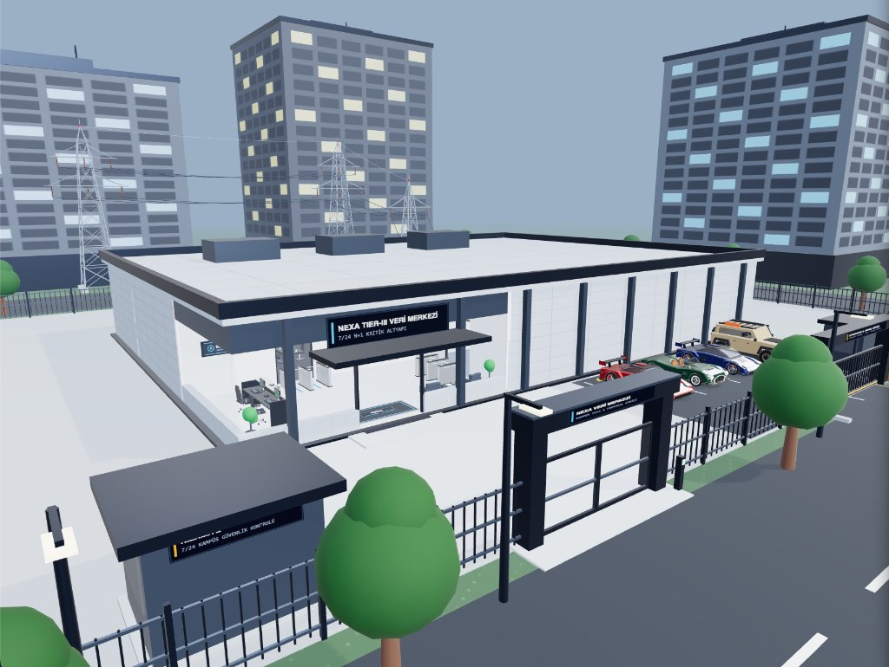
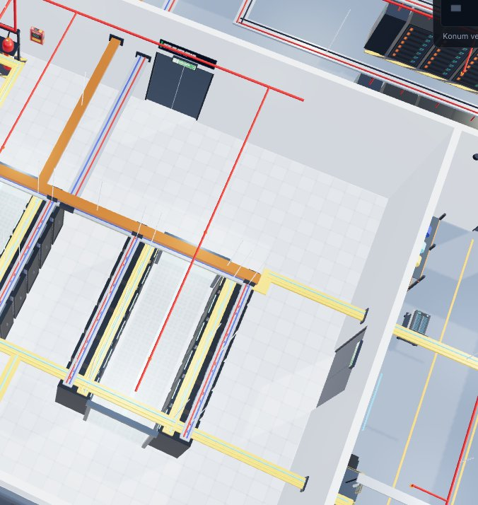
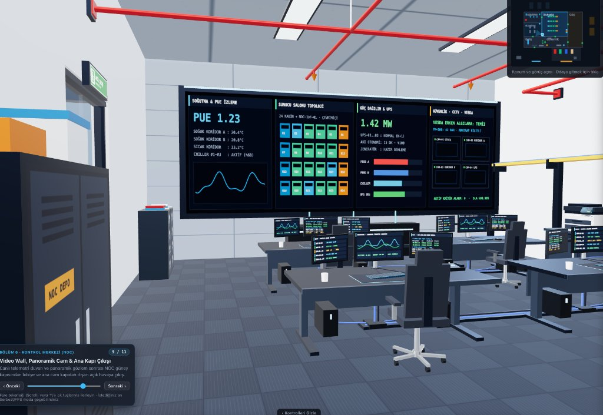
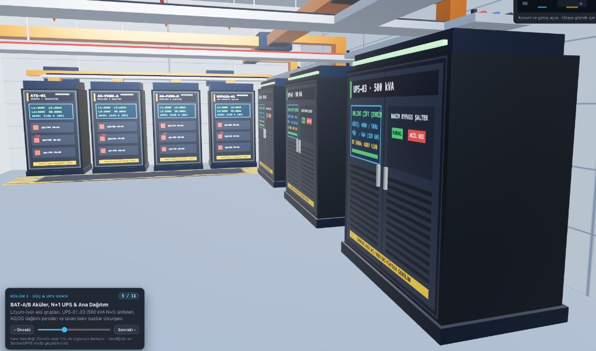
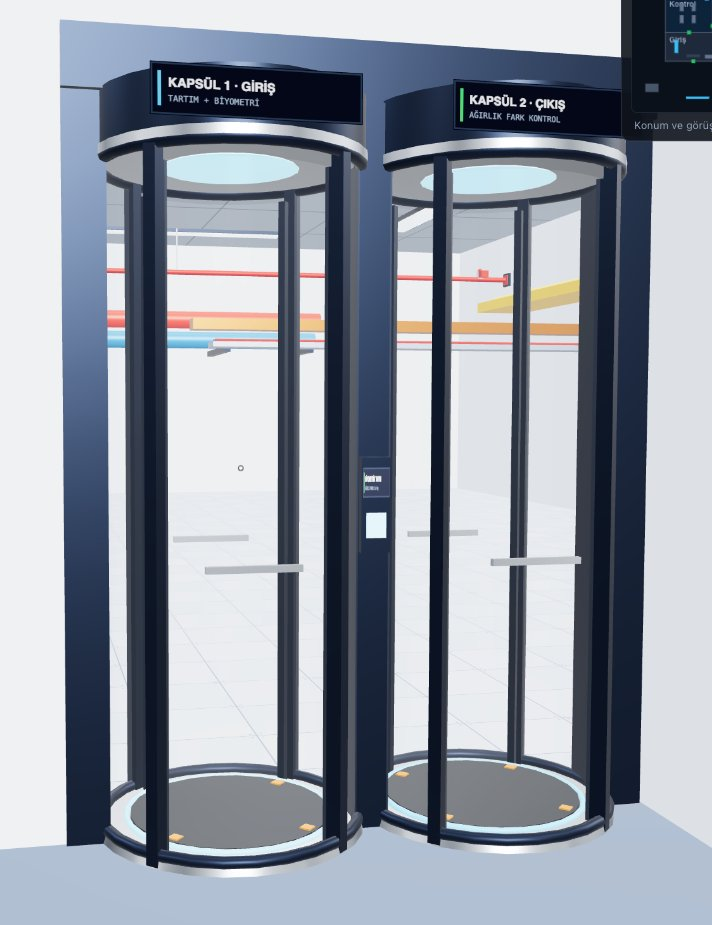

# NEXA Tier-III Veri Merkezi 3D — İnteraktif Mimari & Altyapı Deneyimi

**Canlı Demo (GitHub Pages):** https://tekneenes.github.io/Server/

Zero-build (yalnızca saf ES Modülleri & Three.js) mimarisiyle hazırlanmış, dış kampüsten sunucu salonunun soğuk koridorlarına, güç/UPS omurgasından 7/24 kontrol merkezine kadar gezilebilen gerçek ölçekli interaktif **Tier-III Veri Merkezi 3D** uygulamasıdır.

---

## Ekran Görüntüleri

### Dış Kampüs, Çevre Güvenliği & Çatı HVAC / Paratoner Sistemi


### Ana Sunucu Salonu & Kapalı Soğuk Koridor (24 × 42U Kabin)


### Genel Kontrol Merkezi (NOC — 7/24 Micro-LED Komuta Duvarı)


### Güç & UPS Odası (N+1 UPS, ATS & Bakır Busbar)


### İkili Tartımlı Biyometrik Güvenlik Kapsülü


---

## Öne Çıkan Özellikler

### 1. 24 Adımlı Rehberli Tur & 3 Gezinme Modu
- **Rehberli Tur (Scroll):** Açılış ekranından başlayarak fare tekerleği veya ok tuşlarıyla 7 bölümde 24 sahne kartıyla (`STORY_BEATS`) tüm tesisi adım adım anlatır; 24. final kartındaki **Serbest Moda Geç** veya **İçinde Yürü (FPS)** düğmesiyle tüm kontrol panellerini açar.
- **Serbest Kamera (`Orbit`) & İçinde Yürü (`WASD` FPS):** Çarpışma algılamalı (*collider*) yürüme modu ve tüm bina çatısını kaldıran **Çatı Kesiti** görünümü.
- **Canlı 2D Kat Krokisi:** Anlık konum & görüş açısı göstergesi; kroki üzerinden istenen odaya tek tıkla geçiş.
- **Tıklanabilir Ekipman İnceleyici (*Inspector*):** Kabinler, Chiller, Trafo, Jeneratör, X-Ray, Güvenlik Kapsülü, Paratoner ve CCTV direklerine tıklayarak teknik özellikleri görüntüleme.

### 2. Tier-III (%99.982 Süreklilik) Fiziksel & Teknik Bölümler
- **Dış Altyapı & Çevre Güvenliği:**
  - Yarı yükseklikte betonarme parapet duvar (`1.06 m`) + demir parmaklık çit ve kampüs çevresinde ~`15 m` aralıklı `14` adet çift kameralı (IR Bullet + PTZ Dome) güvenlik direği.
  - `3×850 kW` V-Coil Free-Cooling Chiller sahası ve çift güzergâhlı `ISP-A / ISP-B` yeraltı fiber menholleri.
  - `34.5 kV` OG iletim pilonu, `RMU` hücresi, `TR-01 / TR-02` (`2×3150 kVA`) güç trafoları ve `72` saat yakıtlı `2×2.5 MVA` otomatik senkron dizel jeneratörler.
  - Çatıda `AHU-01..03` taze hava klima santralleri, flanşlı galvaniz kanal ağı + oda tavan difüzörleri, bakır Faraday ağı ve 2 adet **Aktif ESE Paratoner (`PT-01 / PT-02`)**.
- **Giriş Lobisi & Çift Katmanlı Güvenlik:** Resepsiyon, ziyaretçi oturma grubu, optik turnikeler, biyometrik mantrap, `140 kV` çift enerjili **X-Ray Tarayıcı** ve ana sunucu salonu kapısında **İkili Tartımlı Biyometrik Güvenlik Kapsülü** (*load-cell* ağırlık farkı tespiti & kilitli çift kavisli cam kapak).
- **Donanım Hazırlık (Staging):** `SEC-NVR-01` güvenlik kabini, ESD burn-in test masası, `TST-01` ön kurulum kabini, kaldırma arabası ve yedek parça rafı.
- **Güç & UPS Odası:** `BAT-A / BAT-B` (`480V` Li-Ion) akü grupları, `3×500 kVA` `N+1` Online Çift Çevrim UPS, `ATS-01` / `AG-PANO` / `BYPASS-01` panoları ve sunucu salonuna uzanan `Feed-A` (bakır busbar) + `Feed-B` çift hat.
- **Ana Sunucu Salonu:** `BGP-EDGE-01`, `FW-DDOS-01` (`1.2 Tbps`), `400G CORE-SPINE-01`, `MMR-ODF-01` fiber girişi, `Novec 1230` temiz gazlı söndürme, `Soğuk Koridor A & B` (cam tavanlı `24 × 42U` kabin), delikli yükseltilmiş döşeme ve `4× CRAH` hassas klima.
- **Soğutma Odası (Mekanik):** `PHE-01` (`2.4 MW`) plakalı eşanjör, `P-01..03` VFD pompalar, `3000 L` termal tampon tank (`BUFFER-01`), `N+1` merkezi Novec 1230 deposu, glikol dozaj ve canlı Soğutma SCADA ekranı.
- **Genel Kontrol Merkezi (NOC):** 4 panelli canlı Micro-LED telemetri duvarı (`PUE 1.23`, `1.42 MW`), `4×3` monitörlü operatör konsolları, `NOC-IDF-01` kabini ve panoramik sunucu salonu gözlem camı.

### 3. Prosedürel Mekânsal Ses Motoru (`Web Audio API`)
- Harici ses dosyası kullanmadan [src/js/audio.js](src/js/audio.js) ile gerçek zamanlı üretilen odaya özgü sesler (Sunucu Salonu fan uğultusu, Güç Odası `50/100 Hz` trafo vızıltısı, Soğutma Odası pompa/su sesi, dış rüzgâr/Chiller sesi, kapı & güvenlik kapsülü biyometrik sesleri) ve tek tıkla aç/kapat düğmesi.

---

## Yerelde Çalıştırma

Proje hiçbir paket yöneticisi veya derleme adımı (**Vite / Webpack gerekmez**) kullanmaz; doğrudan herhangi bir statik sunucuyla çalışır:

```bash
# Python ile basit yerel sunucu
python3 -m http.server 8080
# Tarayıcıda açın: http://localhost:8080
```

Alternatif olarak VS Code **Live Server** eklentisiyle `index.html` dosyasını başlatabilirsiniz.

---

## Proje Yapısı

```text
├── index.html                   # Uygulama girişi, importmap ve HUD katmanları
├── LICENSE                      # MIT Lisansı
├── README.md                    # Proje dokümantasyonu
├── .nojekyll                    # GitHub Pages statik sunum ayarı
├── .github/workflows/
│   └── build-static.yml         # Otomatik ES Modül doğrulama ve GitHub Pages yayını
├── docs/screenshots/            # README ekran görüntüleri
├── vendor/three/                # Yerel Three.js kütüphanesi & eklentileri
└── src/
    ├── styles.css               # HUD, kroki, anlatım kartları ve kontrollerin stilleri
    ├── three/carsPack.js        # Kampüs otoparkındaki araç modelleri
    └── js/
        ├── main.js              # Sahne başlatma, 24 adımlı tur kartları, culling & döngü
        ├── building.js          # Tüm bina, odalar, güvenlik kapsülleri, HVAC & paratoner
        ├── cabinets.js          # 42U kabinler, kablolama ve LED animasyonları
        ├── exterior.js          # Dış kampüs, Chiller, Trafo, Jeneratör, duvar/çit & CCTV
        ├── controls.js          # Tur eğrisi, Orbit/FPS yürüme, çarpışma & kapı animasyonu
        ├── textures.js          # Prosedürel CanvasTexture ekranlar, tabelalar & X-Ray
        ├── materials.js         # Paylaşılan PBR materyaller ve Shared Geometry Pool
        ├── blueprint.js         # Etkileşimli 2D Kat Krokisi & bölge tespiti
        └── audio.js             # Prosedürel Web Audio API mekânsal ses motoru
```

---

## Lisans

Bu proje [MIT Lisansı](LICENSE) altında lisanslanmıştır.
